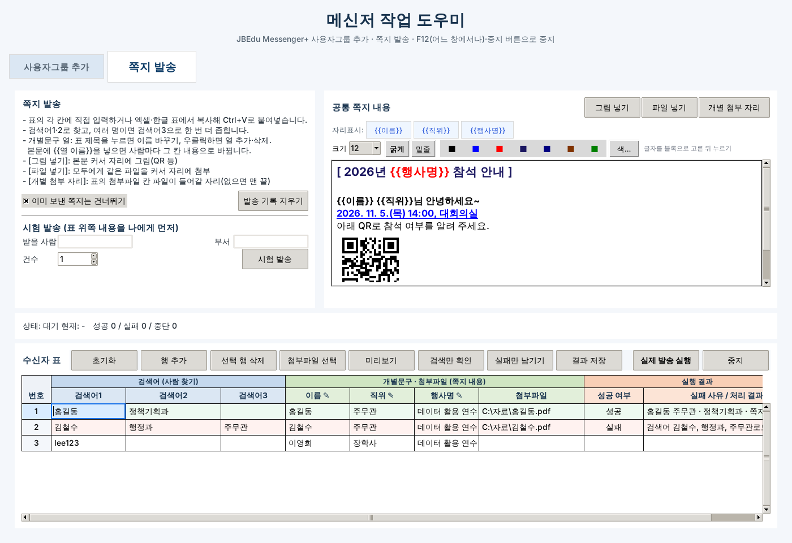
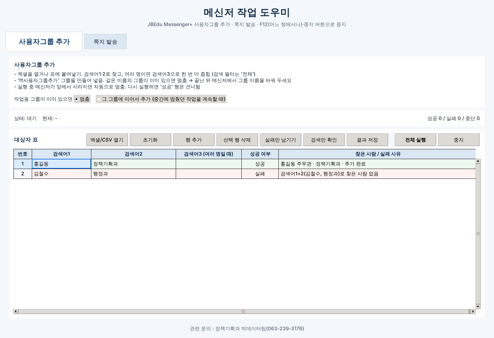

# 메신저 작업 도우미 v3.0


전북특별자치도교육청 JBEdu Messenger+에서 손으로 하던 반복 작업을 대신하는 Windows 프로그램.

- **사용자그룹 추가**: 명단의 사람을 찾아 사용자그룹에 한꺼번에 넣기
- **쪽지 개별 발송**: 사람마다 내용이 다른 쪽지를 서식·그림·첨부파일과 함께 한꺼번에 보내기

메신저 화면을 키보드와 Windows 화면 요소로 직접 조작하는 방식이라 메신저 쪽 설정이나 별도 권한이 필요 없음.

---

## 화면

| 쪽지 발송 | 사용자그룹 추가 |
|---|---|
|  |  |

*(예시 화면 · 이름과 내용은 가짜 자료)*

---

## 주요 기능

### 공통
- **검색 필터 '전체' 고정**: 검색창 앞 필터가 '이름' 등으로 바뀌어 있어도 매번 '전체'로 돌려놓고 검색
- **검색어 1·2·3**: 검색어1로 찾고 검색어2로 '결과 내 재검색'. 여러 명이면 검색어3으로 한 번 더 좁힘. 검색어2가 비면 1 → 3
- **이중 확인**: 찾은 사람 정보에 쓴 검색어가 모두 들어 있는지 다시 확인. 이전 사람의 검색 결과를 잘못 읽는 일 방지
- **자동 멈춤**: 실행 중 메신저가 앞에서 사라지면(다른 창 클릭 등) 그 자리에서 멈춤
- **F12 중지**: 도우미 창이 뒤에 있어도 F12로 중지
- **엑셀처럼 입력되는 표**: 한글 입력 끊김 없음, 엑셀·한글 표 붙여넣기, 범위 선택, 되돌리기(Ctrl+Z)
- **결과 저장**: 실행 결과를 엑셀(xlsx)로 저장. 성공·실패 색 표시
- **작업 기록**: `logs` 폴더에 실행마다 기록

### 사용자그룹 추가
- 작업용 그룹 `!!!사용자그룹추가`를 만든 뒤 찾은 사람을 '내목록 추가'로 넣음
- 같은 이름 그룹이 이미 있으면 멈춤(또는 '그 그룹에 이어서 추가' 선택)
- 끝나면 그룹 이름을 바꾸라는 안내 표시
- 엑셀/CSV 열기, '검색만 확인'(추가하지 않고 검색만)

### 쪽지 발송
- **수신자 표 3구역**: 검색어 / 개별문구·첨부파일 / 실행 결과
- **개별문구 열**: 열 제목을 누르면 이름 바꾸기, 우클릭하면 열 추가·삭제
- **자리표시 `{{열 이름}}`**: 한글 메일머지와 같은 표기. 본문에 넣으면 사람마다 그 칸 값으로 바뀜
- **서식 쪽지**: 글자 크기·굵게·밑줄·색. 한글·워드·웹에서 복사한 서식을 그대로 붙여넣기
- **그림 넣기**: 본문 원하는 자리에 그림(QR 등)
- **파일 넣기**: 모두에게 같은 파일을 본문 원하는 자리에 첨부
- **개별 첨부 자리**: 표의 첨부파일 칸 파일이 들어갈 자리. 없으면 맨 끝
- **미리보기·시험 발송**: 실제 내용으로 미리 보고, 본인에게 먼저 보내 보기
- **발송 기록**: 이미 보낸 쪽지는 다시 실행해도 건너뜀. 같은 사람이라도 내용이 다르면 따로 보냄

---

## 사용 방법

### 쪽지 발송
1. 메신저(JBEdu Messenger+)를 켜고 로그인
2. 도우미의 **쪽지 발송** 탭
3. **공통 쪽지 내용** 작성
   - 한글 문서에서 복사해 붙이면 서식·그림까지 들어옴
   - 사람마다 다른 부분은 `{{열 이름}}`으로 표시
4. **수신자 표**에 명단 붙여넣기
   - 검색어1·2·3: 메신저에서 사람을 찾을 말(이름, 부서, 직위, 메일 아이디 등)
   - 개별문구 열: 열 제목을 본문의 `{{열 이름}}`과 같게
5. **미리보기** → **시험 발송**(본인 이름·부서 입력) → 받은 쪽지 확인
6. **검색만 확인**으로 모두 한 명씩 찾히는지 확인
7. **실제 발송 실행**. 실행 중에는 마우스·키보드를 쓰지 않음

> 메신저 검색은 메일주소 전체로는 결과가 없고, **@ 앞 아이디**로는 그 사람 한 명이 찾힘(직접 확인). 명단에 메일주소가 있으면 아이디만 검색어1에 넣는 방법이 가장 정확함.

### 사용자그룹 추가
1. **사용자그룹 추가** 탭에서 표에 붙여넣기(또는 엑셀/CSV 열기)
2. **검색만 확인** → **전체 실행**
3. 끝나면 메신저에서 `!!!사용자그룹추가` 그룹 이름을 원하는 이름으로 변경

---

## 설치 · 빌드

### 실행 환경
- Windows 10/11, JBEdu Messenger+ 7.x
- 배포는 exe 파일 하나(설치 없음)

### exe 만들기
1. Python 3 설치
2. `v3.0_exe만들기.bat` 실행
   - 필요한 모듈 자동 설치: `pyinstaller pywinauto pywin32 openpyxl pillow`
   - 결과: `dist\전북특별자치도교육청_메신저 작업 도우미(v3.0).exe`

### 파이썬으로 바로 실행
```bat
py -3 -m pip install pywinauto pywin32 openpyxl pillow
py -3 "jbedu_messenger_helper(v3.0).py"
```

### 만들어지는 파일 (exe와 같은 폴더)
| 파일 | 내용 |
|---|---|
| `쪽지내용.json` | 공통 쪽지 내용·개별문구 열 이름(자동 저장) |
| `쪽지설정.json` | 시험 발송 받는 사람 등 |
| `쪽지발송기록.json` | 보낸 쪽지 기록(중복 발송 방지) |
| `쪽지첨부\` | 붙여넣은 그림 사본 |
| `logs\` | 실행 기록 |

배포할 때는 exe만 전달. 위 파일들에는 개인 작업 내용이 들어 있음.

---

## 동작 원리

| 단계 | 방법 |
|---|---|
| 창·칸 찾기 | pywinauto(UIA) + Win32 창 목록. 메신저 창 위치·크기는 건드리지 않음 |
| 검색 필터 | 검색창 → `Shift+Tab`(필터로 이동) → `↑` 여러 번(맨 위 '전체'에서 멈춤) → `Tab`. 값은 UIA로 읽어 확인 |
| 검색어 입력 | 클립보드 붙여넣기 후 검색창 글자를 다시 읽어 확인. 다르면 다시 입력 |
| 결과 확인 | 결과 목록 첫·둘째 줄을 직접 읽어 1명/여러 명 판단. 찾은 사람 정보에 쓴 검색어(메일 아이디 포함)가 모두 있는지 다시 확인 |
| 메뉴 | `VK_APPS` 키로 우클릭 메뉴. 메뉴 첫 줄(사람 이름)을 항목으로 잘못 고르지 않게 정확히 같은 이름 우선 |
| 쪽지 본문 | 서식은 RTF(+유니코드 글자)로 클립보드에 넣어 붙여넣기. 그림은 CF_DIB로 붙여넣기. 첨부는 커서 자리에 들어가는 메신저 동작 이용 → 본문 끝으로 커서를 옮기며 글자·그림·첨부를 순서대로 |
| 입력 확인 | 쪽지 본문 글자 수(EM_GETTEXTLENGTHEX)로 다 들어갔는지 확인 후 전송. 쪽지창이 닫혀야 성공 |
| 안전장치 | 매 단계 앞창이 메신저인지 확인(아니면 멈춤), F12 키 상태 감시, 중지 요청은 단계 사이에서만 처리 |

---

## 제작 과정

### 배경
- 2026년 5급 지방공무원 성과평가 동료평가 안내를 평가자 약 1,500명에게 메일·쪽지로 개별 발송해야 했음
- 사람마다 평가대상자·기관이 달라 한글 메일머지로 만든 문서를 한 명씩 복사해 보내는 방식이었음
- 메일은 별도 크롬·엣지 확장 프로그램으로, 쪽지는 이 도우미로 자동화

### v1.0 (2026-05)
- 사용자그룹 추가 자동화가 출발점
- 원칙: 메신저 창 위치 변경 금지, 좌표 클릭 금지, 키보드·화면 요소 조작만
- 사용자추가 창 안의 검색은 동작하지 않아 **검색 탭에서 찾은 뒤 '내목록 추가'** 방식으로 결정
- 작업용 그룹 이름을 `!!!사용자그룹추가`로 정해 목록 맨 위에 오게 함

### v2.0 (2026-05)
- 쪽지 발송 탭 추가: 수신자명·부서·개별문구 1개·첨부파일 표
- 엑셀식 표, 붙여넣기, 실패만 남기기

### v3.0 (2026-10)
성과평가 쪽지 발송을 계기로 다시 손봄. **성과평가 전용이 아니라, 성과평가 같은 일도 할 수 있는 범용 도구**가 목표.

| 문제 | 해결 |
|---|---|
| 수신자명·부서 칸은 사실 검색 순서일 뿐 | 검색어1·2·3으로 바꾸고, 여러 명일 때만 3을 씀 |
| 검색 필터를 '전체'로 바꾸지 못함(글자를 써 넣는 방식이었음) | 직접 확인 결과 Home·Alt+↓·글자 입력은 안 되고, 목록 안 ↑↓는 끝에서 돌아감 → **필터에 포커스를 두고 ↑**는 맨 위에서 멈춘다는 점 이용 |
| 검색이 가끔 안 먹고 이전 결과를 읽음 | 필터 조작 뒤 포커스를 검색창으로 되돌리고, 검색창 글자를 다시 읽어 확인 |
| 같은 사람을 4번씩 검색함 | 결과 목록 창 글자는 검색해도 바뀌지 않는 값이라 '바뀜' 판단이 늘 틀림 → 그 판단과 재검색을 빼고 결과 줄을 직접 읽음(사람당 검색 2번) |
| 메일주소로는 검색이 안 됨 | 검색어가 메일주소면 @ 앞 아이디로 검색 |
| 0명인데 이전 사람이 1명으로 읽힘 | 원인은 검색어가 검색창에 제대로 안 들어간 것 → 검색창 확인으로 해결. '검색결과 (N명)' 글자는 화면 요소로 읽을 수 없음을 확인 |
| 개별문구가 1개뿐 | 개별문구 열을 원하는 만큼, 열 제목이 곧 `{{자리표시}}` |
| 쪽지에 서식 없음 | RTF 붙여넣기로 크기·굵게·밑줄·색 |
| QR 등 그림 위치 | 메신저 본문이 그림 붙여넣기를 받는 것을 확인 → 본문 원하는 자리에 그림 |
| 첨부파일 위치 | 메신저 첨부가 커서 자리에 들어가는 것을 확인 → 공통 첨부·개별 첨부 모두 본문 자리 지정 |
| 한글 서식 복사가 글자로만 붙음 | 클립보드 HTML 서식을 읽어 그대로 변환(그림 포함) |
| `{}` 표기가 한글 메일머지와 다름 | 메일머지와 같은 `{{열 이름}}` |
| 그룹 찾기가 느림(반복 탐색) | 메뉴 찾기를 Win32 창 목록으로, 가능성 높은 줄부터 확인 |
| 표 입력이 엑셀처럼 매끄럽지 않음 | 보이는 줄만 그리는 표 + 늘 대기하는 입력칸(한글 첫 글자 끊김 해결) |
| F12가 도우미 창이 앞에 있을 때만 됨 | 키 상태를 직접 감시해 어느 창에서나 중지 |
| 결과가 CSV | 엑셀(xlsx)로 저장 |

**만들었다가 뺀 것** — 불필요한 기능은 덜어냄
- 엑셀 파일 직접 열기·대상 고르기·서식 자동 전환(쪽지 탭): 2.0식 붙여넣기 표가 더 단순
- 서식 목록·예시 서식(성과평가 문안 내장): 배포용 범용 도구에 특정 업무 문안은 맞지 않음
- 내용 저장/불러오기: 1년에 한 번 쓸까 말까 한 기능. 자동 저장으로 충분
- 진단 버튼
- 마우스 클릭으로 필터 바꾸기: 키보드 방식(Shift+Tab → ↑)으로 대체

---

## 알려진 한계
- 메신저 화면 구조(7.0.2.11 기준)에 맞춘 조작이라 메신저가 크게 바뀌면 손봐야 함
- 실행 중에는 마우스·키보드를 쓰면 안 됨(앞창이 바뀌면 자동으로 멈춤)
- 본문 그림·첨부 위치는 메신저 동작에 의존 → 큰 발송 전에는 꼭 시험 발송으로 확인

---

## 파일 구성
```
jbedu_messenger_helper(v3.0).py     프로그램 전체(하나의 파일)
jbedu_messenger_helper(v3.0).spec   PyInstaller 설정
v3.0_exe만들기.bat                  exe 만들기
assets/                             아이콘
tools/build_icon.py                 아이콘 생성 스크립트
docs/                               README 화면
```

## 버전 이력
| 버전 | 날짜 | 내용 |
|---|---|---|
| v1.0 | 2026-05 | 사용자그룹 추가 자동화 |
| v2.0 | 2026-05 | 쪽지 발송 탭(개별문구 1개, 첨부파일) |
| v3.0 | 2026-10 | 검색어 1·2·3, 필터 '전체' 고정, 결과 이중 확인, 서식·그림·첨부 위치 지정 쪽지, `{{열 이름}}`, 구역 나눈 표, xlsx 결과, F12 어디서나 중지, 아이콘 |

---

문의: 전북특별자치도교육청 정책기획과 빅데이터팀
